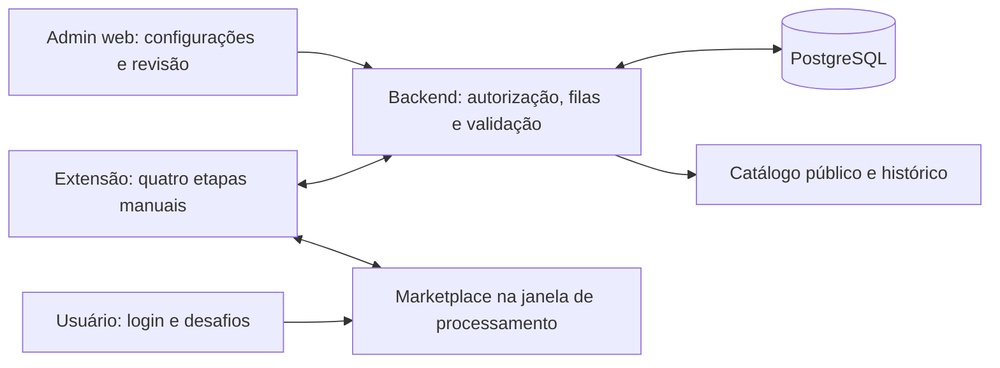

# Plano de migração do catálogo para a extensão do Chrome

Documento de execução faseada — 19/10/2026.

Workspace de referência: `F:\OneDrive\Repos\espertinho`, no PC utilizado nesta conversa. Antes de executar alterações em outra máquina, confirmar o destino. Este documento registra o plano; não altera serviços, banco, configurações ou deploys.

## 1. Objetivo e decisões acordadas

Concentrar no Chrome do administrador toda atividade que exige navegação em marketplaces. A extensão utiliza a sessão local e permite intervenção humana em login, CAPTCHA e outras confirmações. O backend continua sendo a autoridade sobre permissões, configurações, filas, validações, catálogo e publicação.

Fluxo operacional final:

1. Manter no admin os marketplaces, perfis de exploração, páginas de vitrines e seletores de produtos.
2. Na extensão, selecionar o marketplace e iniciar **1 — Extrair links**.
3. Iniciar **2 — Gerar links de afiliados** para os links descobertos e ainda não convertidos.
4. Iniciar **3 — Extrair informações dos produtos** para os links convertidos.
5. No admin, confirmar a categorização e atribuir um produto existente ou criar um produto com os dados extraídos previamente preenchidos.
6. Revisar a prévia e publicar explicitamente.
7. Periodicamente, iniciar **4 — Atualizar preços** para as ofertas existentes.

Cada botão é manual e independente. Uma etapa não dispara automaticamente a seguinte. O novo fluxo não inclui agendamento autônomo no servidor ou processamento garantido com o computador desligado, suspenso ou com o Chrome encerrado.

### Regras que devem permanecer

- Nenhuma implementação, seletor, endpoint ou identificador específico de marketplace fixo no código. Não introduzir ASIN como requisito de negócio.
- Receitas e seletores são configurações validadas; não são JavaScript remoto, `eval`, plugins ou scripts arbitrários.
- A sessão do marketplace permanece no navegador. Não enviar cookies, Authorization, tokens CSRF, localStorage, sessionStorage, perfis de navegador ou HTML integral ao backend.
- A extensão pode usar localmente valores necessários à receita. Preferir variáveis transitórias; não persistir segredos de marketplace no disco nem no estado de progresso.
- Não resolver CAPTCHA automaticamente, imitar comportamento humano, ocultar automação ou trocar identidades para contornar um bloqueio. Pausar e permitir resolução pelo usuário na mesma sessão.
- Preservar autenticação da extensão, revogação, permissões e controle de origem. Token do Espertinho nunca é injetado no marketplace ou disponibilizado à receita.
- Link descoberto é candidato à revisão, não oferta publicada. Uma oferta exige produto; um produto pode existir sem ofertas e permanecer fora da vitrine.
- Categoria de origem é extraída na página do produto. Mapeamentos anteriores são sugestões; exigem confirmação por item.
- Não inferir produtos diferentes apenas por cor, tamanho ou tensão. A vinculação ao produto permanece manual.
- Ofertas não são publicadas, recategorizadas ou desvinculadas automaticamente por uma extração.
- Produtos continuam com árvore de categorias de até dez níveis e vitrines dos ancestrais.
- Listas administrativas usam paginação com tamanho selecionável; cards seguem a convenção de rolagem infinita existente.

## 2. Levantamento do estado atual

Os itens abaixo foram conferidos nos arquivos locais. Não representam auditoria completa de ambiente remoto ou confirmação de todas as configurações de produção. Há documentação antiga com informações divergentes; código, migrations aplicadas e comportamento validado devem orientar a implementação.

| Projeto/componente | Papel atual identificado | Destino planejado |
|---|---|---|
| `1-backend` | API, autenticação, revisão, configurações e clientes/filas dos serviços | Manter e refatorar para coordenar a extensão |
| `2-frontend` | Catálogo público e administração | Manter; adaptar configurações, acompanhamento e prévia |
| `o-espertinho-chrome-extension` | Login, executor configurável, seletor visual, painel/popup, demonstração e POCs | Tornar executor único dos quatro passos |
| `o-espertinho-job-discovery` | Descoberta manual em container | Desativar após substituir o passo 1 |
| `o-espertinho-job-enrich-links` | Enriquecimento manual em container | Desativar após substituir o passo 3 |
| `o-espertinho-job-update-price` | Atualização de preços, disponibilidade e histórico | Desativar após substituir o passo 4 |
| `o-espertinho-extractor` | Extração manual/prévia/teste de seletores e prova de sessão | Desativar somente após substituir também os fluxos manuais |
| `o-espertinho-extraction-core` | Biblioteca Node/Playwright e proteções de navegação no servidor | Avaliar dependências; retirar do runtime se não houver consumidor |
| `scripts/project.mjs` e `package.json` da raiz | Setup e comandos que instalam/provisionam/iniciam os serviços | Simplificar no encerramento da migração |

### Pontos de entrada e dados a considerar

- Backend: `src/discovery-config.ts`, `discovery-admin.ts`, `discovery-runs.ts`, `enrichment-admin.ts`, `offer-refresh.ts`, `price-history.ts`, `scraping-admin.ts`, `manual-extractor.ts`, `manual-extractor-profile.ts`, `extraction-data.ts` e normalizadores de URL.
- Extensão: `src/runtime.ts`, `contracts.ts`, `executor.ts`, `request-header-memory.ts`, `session-proof.ts`, `background.ts`, `popup.ts`, `popup-view.ts`, `display-mode.ts`, `selector-picker.ts` e `picker-launcher.ts`.
- Frontend: `pages/admin.page.*` e componentes `discovery-admin.*`, `enrichment-admin.*`, `catalog-admin.*`, `offer-refresh-admin.ts` e `products-admin.ts`.
- Tabelas existentes relevantes: `discovery_profiles`, `discovery_sources`, `discovery_links`, vínculos de origem, execuções/eventos de descoberta, `enrichment_settings`, `enrichment_runs`, `enrichment_items`, `category_mappings`, `offers`, `products`, `category_nodes` e `offer_price_history`.
- Migrations já existentes: `019_extension_access.sql`, `022` a `027` para exploração/revisão, `028_affiliate_proof_recipes.sql` e migrations anteriores de atualização e histórico.
- A migration `027` invalida a atribuição do produto quando a categoria confirmada muda. Preservar essa proteção e a compatibilidade entre produto e categoria.
- O backend ainda tem um worker próprio em `src/worker-runtime.ts`. Inspecionar `workerTick` e seus efeitos antes de removê-lo: manutenção de sessões, retenção e outras rotinas sem navegador precisam continuar existindo.

### Provas de conceito e resíduos conhecidos

| Área | Referências atuais | Tratamento planejado |
|---|---|---|
| Demonstração da extensão | `1-backend/src/extension-mock.ts`, fila em memória, comandos e telas demonstrativas | Separar autenticação reutilizável do mock; substituir fila por persistência real |
| Conversão antes do enriquecimento | `affiliate-proof.ts`, tabela `affiliate_proof_recipes`, comandos `AFFILIATE_*`, `docs/AFFILIATE_PROOF.md` | Migrar receitas válidas e recursos genéricos para fluxo definitivo; retirar limites e contratos exclusivos da prova |
| Exportação de sessão para container | `extension-session-proof.ts`, `session-proof.ts`, rota `/v1/session-proofs`, permissão opcional `cookies` | Remover após migração; novo desenho não exporta sessão |
| Interação remota incompleta | `o-espertinho-extractor/src/interactive-proof.ts` e alterações em `src/contracts.ts` | Há alterações locais não commitadas. Inspecionar e registrar o conteúdo antes de decidir sua remoção; não incluí-las incidentalmente em outra entrega |
| Experimentos locais | `reports/`, screenshots, scripts de diagnóstico, imagens Docker de teste e arquivos ignorados | Inventariar, separar evidência útil de resíduos e limpar no encerramento; não versionar sessões ou segredos |
| Integrações históricas | `providers.ts`, OAuth, SiteStripe, importações e buscas automáticas antigas | Levantar consumidores e rotas reais. Retirar apenas o que estiver substituído/sem uso; não manter alternativa fixa por marketplace |

Não apagar migrations aplicadas, nem considerar um arquivo obsoleto apenas pelo nome. Cada remoção precisa de análise de consumidores, substituição e teste de regressão.

## 3. Arquitetura pretendida

A extensão não recebe acesso ao PostgreSQL. O backend não inicia um navegador nem solicita a sessão do marketplace. O painel lateral mostra o progresso, mas o estado da execução não depende de ele estar aberto.

### Execução e estados

Manter separados o estado técnico da execução e o estado comercial do candidato/oferta. Não condensar tudo em um único status.

- Execução: proposta de estados `queued`, `running`, `paused_by_user`, `waiting_for_human`, `paused_technical`, `completed`, `failed`, `cancelled`, com transições explícitas.
- Item: pendente, reservado, concluído, falhou ou ignorado, com código de motivo, tentativas e versão.
- Candidato: descoberta, conversão e extração têm resultados independentes; categoria confirmada, produto atribuído, arquivamento e publicação mantêm seus próprios dados.
- A execução captura um snapshot/versionamento da configuração. Alterações no admin passam a valer para a próxima execução; uma retomada usa o snapshot original, salvo migração explícita.
- Uma execução ativa de navegação por marketplace, compartilhada entre os quatro passos, inclusive entre dispositivos e durante a coexistência com consumidores antigos. Inicialmente, uma execução total por instância da extensão simplifica o uso; paralelismo é evolução posterior.
- Banco mantém reserva temporária, prazo, heartbeat e identidade da instalação/executor autenticado. Uma mensagem de início não deve ser suficiente para sequestrar execução de outro administrador.
- Espera humana não prende uma reserva indefinidamente: definir prazo, preservação do item, expiração e retomada explícita. Expiração não dispara processamento automático em outra janela.
- Cancelamento invalida novas gravações imediatamente. Respostas tardias, reservas vencidas e versões antigas são recusadas.
- Cada resultado possui chave de idempotência. Se a resposta do backend se perder, o reenvio não duplica links, ofertas nem histórico.
- O backend calcula contadores a partir dos resultados aceitos. Não confiar em totais arbitrários enviados pela extensão.

### Modelo de API e persistência

Projetar uma API real de operações da extensão, separada das rotas de POC. Nomes finais de endpoints e tabelas serão definidos na fase 1, documentados no OpenAPI e não devem ser presumidos como implementados por este plano.

Contratos necessários: configurações por marketplace; fontes habilitadas; iniciar/listar/detalhar execução; reservar lote; renovar reserva/heartbeat; enviar resultados; pausar/continuar/cancelar; consultar pendências e prévias manuais. Paginar leituras e limitar tamanho de lotes e payloads.

Preferir reuso das entidades de descoberta, revisão e ofertas já existentes. Acrescentar executor/versão e estados quando isso preservar a semântica; criar tabelas específicas quando os contratos forem diferentes. A decisão precisa de um mapa explícito de compatibilidade para cada tabela e índice legado, não de renomeação indiscriminada de colunas.

## 4. Fases de implementação

Todas as fases abaixo começam pendentes. Cada fase deve produzir uma entrega revisável com evidências de aceite antes da seguinte. Atualizar a PR já aberta em cada repositório; só criar nova PR quando não houver uma pendente. Não fazer merge, release, deploy, arquivamento de repositório ou exclusão de infraestrutura por consequência automática deste documento.

### Fase 0 — Inventário verificável e preparação

**Projetos:** workspace e todos os repositórios.

1. Registrar branches, PRs abertas, modificações locais, consumidores e versões dos pacotes.
2. Mapear cada botão/tela → rota → tabela → executor atual. Incluir cadastro manual, preview, teste de seletor, publicação, atualização, retenção e buscas históricas.
3. Classificar módulos como manter, adaptar, substituir ou remover. Registrar dependências em código, testes, OpenAPI, migrations, Compose, workflows, variáveis, grants e documentação.
4. Inspecionar as alterações locais da prova remota sem descartá-las; registrar a decisão de destino.
5. Preparar banco descartável e dados de teste representativos. Registrar procedimento de backup e restauração antes de migrations de dados reais.
6. Definir uma chave de seleção do executor por fluxo/marketplace para a coexistência. Nenhum fluxo pode ser consumido pelos dois executores.

**Aceite:** inventário rastreável, teste de restauração em ambiente isolado e lista de fluxos sem cobertura conhecida. Nenhum serviço desligado e nenhum dado real apagado nesta fase.

### Fase 1 — Contratos reais, banco e autorização

**Projetos:** backend e extensão; frontend para tipos/contratos necessários.

1. Separar autenticação real da extensão do registro de rotas demonstrativas. O fluxo definitivo deve funcionar em produção sem habilitar mocks/POCs.
2. Manter a exigência atual de permissão para gerar links; definir uma matriz adicional para descoberta, extração, atualização, configurações e revisão. Migração inicial deve conservar o acesso autorizado do administrador, sem ampliar acesso de usuários comuns.
3. Implementar execuções, itens, exclusão mútua por marketplace, leases, heartbeat, idempotência, snapshots e concorrência otimista.
4. Implementar API de configuração e resultados com validação estrita, limites e auditoria; autenticar também consultas de status e retomadas.
5. Criar migrations novas e compatíveis; preservar dados, FKs, históricos e checksums das migrations antigas. Ajustar grants da API pelo menor privilégio.
6. Definir tratamento de logout, token revogado, permissão removida, instalação diferente e troca de backend: parar ou pausar sem continuar usando a sessão antiga.
7. Atualizar OpenAPI e testes de autorização, origem, concorrência, duplicação de resultados e reservas expiradas.

**Aceite:** operações persistidas sobrevivem a reinício do backend; duas extensões não processam o mesmo marketplace; resultado tardio/cancelado é rejeitado; nenhum resultado pode publicar oferta.

### Fase 2 — Configurações administrativas e detecção de bloqueios

**Projetos:** backend, frontend e contrato da extensão.

1. Reaproveitar cadastros de perfis, vitrines, domínios, normalização de URLs e seletores de produtos.
2. Disponibilizar receita de conversão por marketplace: origem/contexto da aba, endpoint, método, cabeçalhos permitidos, corpo, variáveis transitórias e campo de saída. Migrar receitas válidas da POC mediante validação.
3. Impedir cabeçalhos reservados, segredos fixos em receitas, redirecionamentos não autorizados, chamadas a outra origem e scripts arbitrários. Se uma necessidade não couber na receita, registrar como não suportada.
4. Cadastrar regras de login, CAPTCHA, acesso negado, limitação de chamadas, indisponibilidade explícita e página incompleta. Suportar padrões de URL, seletores e texto limitado; respostas HTTP só quando observáveis pela operação executada. Não depender de status HTTP de navegação que a API usada não disponibilize.
5. Cada regra informa motivo, prioridade e ação. Estado desconhecido/incompleto não equivale a indisponível. Login/desafio pausam a fila; 429 e falhas transitórias usam espera limitada ou pausa, sem insistência infinita.
6. Configurar timeouts, intervalo entre itens, limite de páginas/itens, tentativas, prazo de intervenção e comportamento de falha. Preservar mínimo configurável de 100 ms sem usar esse mínimo como recomendação de tráfego.
7. Manter paginação opcional. Configurações de clique em próximo, URL seguinte, carregar mais e rolagem devem ter capacidades explícitas; não prometer compatibilidade universal. Perfil sem paginação processa uma página.

**Aceite:** configuração de teste funciona para mais de um marketplace sem branch por nome/domínio; campos explicam escopo e opcionalidade; receitas e regras inválidas são recusadas nos dois lados.

### Fase 3 — Motor de navegação da extensão

**Projeto:** extensão; backend para acompanhamento.

1. Refatorar o runtime em módulos de autenticação, cliente da API, coordenador, navegação, receitas, extração, estado local e interface. Preservar seletor visual, painel/popup e preferência salva.
2. Criar/reutilizar uma janela de processamento identificada por IDs próprios. Não navegar na aba que o usuário estiver usando nem selecionar sempre a aba ativa da última janela focada.
3. Conceder acesso apenas aos domínios necessários, com permissão explícita. `activeTab` sozinho não sustenta acesso contínuo a outros sites e abas.
4. Navegar por API, acompanhar carregamento e esperar os seletores/valores com prazo. Rejeitar destinos externos não autorizados. Não mover o ponteiro físico ou disputar o teclado do usuário.
5. Manter checkpoint durável no backend e progresso local mínimo, versionado e sem segredos. Suportar suspensão do service worker, fechamento do painel, reload da extensão, perda de rede e respostas pendentes de confirmação.
6. Mostrar no painel execução atual, contadores, motivo de pausa, item atual sem dados sensíveis, última comunicação e ações pausar/continuar/cancelar/abrir janela.
7. Ao detectar login/desafio, preservar aba e contexto, destacar necessidade de intervenção e aguardar ação explícita. Reavaliar a regra antes de continuar; desafio não resolvido mantém a pausa.
8. Tratar aba fechada, URL alterada pelo usuário, permissões revogadas, janela minimizada, aba congelada/descartada e suspensão do computador. Não garantir execução invisível ou enquanto o PC estiver desligado.
9. Usar um detector genérico nos quatro passos. Nunca acionar automaticamente elementos classificados como resolução de CAPTCHA.

**Aceite:** usuário utiliza outra janela normalmente; login é resolvido manualmente na mesma sessão; fechar painel não apaga progresso; reinício não duplica resultados; nenhuma sessão de marketplace chega à API.

### Fase 4 — Passo 1: extrair links das vitrines

**Projetos:** extensão e backend; frontend para acompanhamento.

1. Buscar fontes habilitadas e perfis versionados do marketplace selecionado.
2. Percorrer as vitrines dentro dos limites configurados, selecionar cards e localizar o link relativo ao card. Resolver URLs relativas pela URL/base efetiva da página, nunca pela origem do backend.
3. Restringir o escopo ao documento/frame suportado; seletores em iframe ou shadow DOM não suportado devem produzir diagnóstico, não resultado presumido.
4. Enviar lotes limitados com URL original, fonte e evidências mínimas. O backend revalida domínio e normalização antes de persistir e deduplicar.
5. Aplicar normalização de URLs originais: descartar query e fragmento e aplicar regras de caminho configuradas, incluindo a remoção do sufixo `/ref=` já cadastrada na Amazon. Não estender essa regra às URLs de afiliado.
6. Preservar múltiplas fontes para o mesmo link. Itens arquivados continuam arquivados e não voltam à fila por redescoberta.
7. Detectar página repetida, ausência de progresso, próximo desabilitado, fim da listagem e limites; distinguir conclusão normal de erro.
8. Não extrair título, preço, imagem, marca ou breadcrumb da vitrine. Essa etapa descobre somente URLs e procedência.

**Aceite:** validar fonte sem paginação e fonte paginada; respeitar limite de uma página quando configurado; repetir execução sem duplicação; cancelamento preserva links já aceitos. Só então migrar esse fluxo do job de descoberta.

### Fase 5 — Passo 2: gerar links de afiliados

**Projetos:** extensão, backend e configuração no admin.

1. Selecionar candidatos não arquivados e ainda sem URL de afiliado. Categoria e produto não são pré-requisitos neste novo fluxo.
2. Executar a receita no contexto autorizado do marketplace usando a sessão do Chrome. Reutilizar as capacidades genéricas úteis do executor e da memória transitória de cabeçalhos.
3. Receber do navegador apenas o resultado permitido da receita; não capturar/exportar tráfego completo, cookies ou estado autenticado.
4. Validar formato, comprimento, HTTPS, domínio permitido de saída e identidade do item/reserva. URL válida não comprova comissão ou venda.
5. Salvar URL de afiliado separada da identidade original. Preservar parâmetros necessários à atribuição; não aplicar a remoção de query/fragmento dos links originais à URL de afiliado.
6. Em login expirado/desafio, pausar. Em falha individual, registrar motivo e permitir retentativa seletiva sem reconverter os concluídos.
7. Diferenciar receita inexistente/não suportada de erro do marketplace; permitir correção e nova execução sem publicação automática.

**Aceite:** lote real pequeno convertido na extensão, resultados persistidos e reenvio idempotente. Nem cookies nem headers sensíveis aparecem em payloads, banco de negócio, logs, artefatos ou tela.

### Fase 6 — Passo 3: extrair informações dos produtos

**Projetos:** extensão e backend; frontend de revisão.

1. Selecionar links convertidos e pendentes/falhos de extração; navegar pela URL de afiliado sem substituir a identidade original descoberta.
2. Aplicar seletores de produto cadastrados: nome, descrição, marca, imagens, preço, condições, disponibilidade e caminho de categorias de origem. Preservar opções já suportadas de atributos, alternativas e composição de preço.
3. Separar as regras puras de leitura/normalização do código que depende de Playwright. Reaproveitar comportamento mediante contratos e testes; não importar a biblioteca Node com suas dependências de servidor diretamente no bundle da extensão.
4. Validar o redirecionamento final e os domínios permitidos. Ler conteúdo como dados não confiáveis; limitar tamanho, quantidade de imagens e campos, e não renderizar HTML arbitrário.
5. Persistir observação, data, versão, campos ausentes, motivo de falha e árvore ordenada de origem. Caminho completo e marketplace identificam o mapeamento, não apenas o último nome da categoria.
6. Falha técnica preserva a observação anterior. Ausência de preço sem indicador explícito de indisponibilidade é inconclusiva.
7. Categoria de origem ausente aparece como pendência para resolução manual; não inventar categorias a partir do título.
8. Preencher sugestões por mapeamentos anteriores sem confirmar categoria, atribuir produto ou publicar.

**Aceite:** resultados equivalentes ao contrato de extração esperado, caminhos de categorias preservados e sugestões visíveis sem confirmação automática. Reextração não apaga dados válidos nem sobrescreve edição administrativa sem controle de versão. Só então migrar o enriquecimento do container.

### Fase 7 — Revisão, vínculo e publicação

**Projetos:** frontend e backend.

1. Consolidar Revisão de ofertas como lista paginada, com filtros por marketplace, estágio e categorias de origem; manter menu flutuante de ações.
2. Exibir irregularidades, sugestões e diferenças entre observação e dados confirmados, sem expor segredos ou IDs internos ao público.
3. Categorizar: selecionar árvore existente ou criar até dez níveis no próprio modal; confirmar o item e, quando escolhido pelo administrador, salvar/alterar o de-para.
4. Uma mudança no mapeamento atualiza sugestões dos demais itens, sem transformar sugestões em confirmações em massa. Manter tela de gestão/exclusão de mapeamentos.
5. Atribuir produto somente após categoria confirmada: pesquisar produtos da árvore, selecionar existente ou criar com nome, descrição, marca e imagem preenchidos e editáveis.
6. Arquivar impede novas etapas e redescoberta elegível. Detalhar mostra a prévia. Retentar atua somente sobre falhas elegíveis.
7. Publicar exige categoria confirmada, produto válido, URL de afiliado e dados obrigatórios coerentes. Revalidar tudo no backend e impedir duplicação da mesma oferta por repetição do comando.
8. Remover a obrigação antiga de gerar link só após atribuir produto: a conversão agora ocorre no passo 2. A revisão exibe o estágio e pode orientar a abertura da extensão para resolver pendências.
9. Preservar as regras de invalidação quando categoria/produto mudarem. Uma simples mudança no mapeamento sugerido não deve desfazer confirmações já revisadas.

**Aceite:** candidato nunca aparece na vitrine antes de publicar; ações não autorizadas são recusadas no backend; o fluxo funciona sem código fixo por marketplace.

### Fase 8 — Passo 4: atualizar preços e disponibilidade

**Projetos:** extensão, backend e frontend.

1. Gerar fila de ofertas publicadas com URL de afiliado, incluindo disponíveis e indisponíveis que precisam ser reavaliadas. Definir explicitamente a exclusão de arquivadas/encerradas, para não reabrir ofertas intencionalmente encerradas.
2. Reutilizar seletores, motor e detector de bloqueios; permitir atualização parcial, retentativa de falhas e acompanhamento por marketplace.
3. Resultado disponível atualiza preço e data da observação. Indisponibilidade explícita atualiza disponibilidade. Falha técnica mantém preço/disponibilidade anteriores e sinaliza **Atualização pendente**.
4. Preservar a regra de preço ausente para estados inconclusivos: não encerrar oferta apenas porque o seletor não retornou valor ou houve login/desafio.
5. Atualizar oferta e `offer_price_history` na mesma transação. Um registro por oferta/dia em `America/Sao_Paulo`, sobrescrito pela observação confirmada mais recente; falha técnica não grava preço zero ou apaga o preço do dia.
6. Definir ordenação pela hora da observação validada, com limites de desvio de relógio; resultado antigo entregue com atraso não pode sobrescrever observação mais nova. Não fabricar observações de dias em que não houve coleta.
7. Preservar retenção de 365 dias, gráficos, agregação diária pelo menor preço entre ofertas e faixas mínima/máxima dos produtos. Manter tratamento já definido para indisponibilidade e pontos sem preço.
8. Refatorar a aba Atualizações: mostrar última execução, pendências, idade dos dados e instrução de iniciar pela extensão. Retirar agendamento/periodicidade automática e disparos antigos somente no corte desse fluxo; manter intervalos entre consultas configuráveis.
9. Eliminar disparo manual do worker antigo como caminho alternativo após o corte. A tela pode orientar/abrir a extensão mediante ação do usuário, sem prometer acesso a extensão ausente.

**Aceite:** duas atualizações no mesmo dia deixam um registro; dia seguinte cria outro; resposta atrasada não regride preço; falha técnica mantém oferta na vitrine com pendência; indisponibilidade confirmada segue as regras de exibição. Só então desligar o job de preços para o marketplace migrado.

### Fase 9 — Substituir prévia manual e testes de seletores

**Projetos:** frontend, backend e extensão.

1. Inventariar todos os consumidores de `manual-extractor.ts`, não apenas cadastro de link.
2. Cadastro manual cria solicitação autenticada com URL, marketplace, produto quando aplicável e snapshot do perfil; a extensão reserva a solicitação e devolve a observação.
3. Frontend acompanha solicitação com prazo, cancelamento e estados claros para extensão ausente, desconectada ou pausada. Aguardar resultado antes de confirmar a prévia.
4. Teste de seletores usa o mesmo mecanismo, sem criar publicação, candidato ou produto automaticamente.
5. Definir identificação segura de solicitações ao abrir a extensão: apenas ID opaco e backend previamente autorizado; não passar tokens pela URL nem aceitar mensagens de páginas arbitrárias.
6. Solicitações manuais respeitam a exclusão mútua por marketplace. Não interromper silenciosamente o lote em andamento; aguardar ou pedir pausa explícita.

**Aceite:** cadastro manual, prévia, reextração e teste de seletor funcionam sem container extrator. Uma solicitação de usuário A não pode ser lida ou completada por identidade sem permissão/propriedade adequada.

### Fase 10 — Homologação e corte operacional

**Projetos:** todos os consumidores ativos e infraestrutura.

1. Validar em ambiente isolado os quatro passos e o caminho manual, incluindo login humano e interrupções. Para plataformas reais, usar lotes pequenos autorizados; não criar carga de testes agressiva.
2. Selecionar executor por marketplace/fluxo. Fazer transição com exclusão mútua e drenagem: parar novas reservas antigas, aguardar/encerrar execuções, reconciliar estados e liberar o executor novo.
3. Em caso de reversão, congelar a nova fila e invalidar suas reservas antes de restaurar o consumidor antigo. Converter apenas estados necessários; preservar resultados aceitos e nunca reiniciar as duas versões sobre a mesma fila.
4. Comparar dados e efeitos comerciais, não apenas número de itens: duplicações, categorias, preços, datas, histórico e visibilidade pública.
5. Confirmar autenticação em produção, permissões de hosts, backend HTTPS permitido e comportamento de distribuição/atualização da extensão.
6. Desativar agendamentos legados de navegador e rotas de disparo incompatíveis, mantendo manutenção interna sem navegador.
7. Registrar data do corte, responsáveis, evidências, versão da extensão e procedimento de recuperação.

**Aceite:** cada fluxo tem um único executor; nenhuma fila antiga fica travada; todos os consumidores manuais estão substituídos. Testes de falha não causam perda de catálogo ou publicação indevida.

### Fase 11 — Limpeza de código, banco, infraestrutura e POCs

**Projetos:** todos; somente após os aceites anteriores.

1. Remover telas, comandos, contratos, estados, temporizadores e handlers demonstrativos/POCs da extensão. Preservar autenticação, receitas genéricas, seletor visual e painel/popup.
2. Remover captura/exportação de sessão, opção de envio de storage, permissão `cookies` se não houver uso legítimo restante e permissões/observadores de rede que não forem necessários às receitas definitivas. Se `webRequest` continuar necessário, limitar captura por configuração, origem, aba e prazo.
3. Retirar do backend as rotas de provas, filas em memória, opções `EXTENSION_MOCK_*` sem função e dependências do extrator remoto. Migrar receitas reais de `affiliate_proof_recipes` antes de remover a tabela por migration nova.
4. Levantar rotas antigas de integrações, OAuth, sessões de navegador, importações e buscas automáticas. Remover o que não tiver consumidor após o corte, junto de OpenAPI, permissões, campos de tela, testes exclusivos e variáveis correspondentes.
5. Substituir testes de POC por testes dos contratos definitivos. Manter testes de segurança e regressão relevantes; não apenas apagá-los para elevar cobertura.
6. Retirar containers, imagens de build, portas, healthchecks e secrets dos quatro serviços de navegador do setup/deploy ativos. Atualizar `scripts/project.mjs`, scripts raiz e dos consumidores, Compose e documentação de primeiro uso.
7. Novo `npm run setup` deve preparar somente os componentes ainda necessários, subir PostgreSQL com detach e aplicar migrations, sem abrir CMD adicional ou iniciar front/backend juntos.
8. Migrar e depois remover tabelas/colunas legadas apenas mediante mapa de consumidores e FKs. Preservar histórico comercial, candidatos, origens, arquivamentos e auditoria. Não reescrever migrations aplicadas nem zerar banco por conveniência.
9. Revogar contas/grants de banco dos jobs e segredos máquina-a-máquina após desligar todos os consumidores. Fazer a rotação das credenciais afetadas sem apagar credenciais atuais da API.
10. Retirar dependências Playwright/CDP/Xvfb do runtime ativo quando não houver consumidor. Não remover o worker de manutenção ou dependências compartilhadas sem inspecionar seus usos restantes.
11. Desabilitar deploys e agendamentos dos serviços aposentados. Separar a decisão de arquivar repositórios, encerrar projetos Sonar e remover acesso ao pacote privado; preservar tags/evidências de recuperação. Não excluir repositórios, pacote ou releases automaticamente.
12. Avaliar a biblioteca `o-espertinho-extraction-core`: se sem consumidor, descontinuar de forma documentada; se houver regras puras úteis, extrair pacote compatível com navegador apenas quando necessário, sem criar outra camada por antecipação.
13. Limpar relatórios temporários, imagens Docker de POC, artefatos antigos, arquivos ignorados e alterações locais incompletas após registrar evidências e confirmar seus destinos. Nunca usar remoção recursiva ampla ou apagar volumes do banco.
14. Atualizar README de todos os projetos ativos, instruções do ZIP, `.env.example`, workflows, diagramas e guias das POCs. Mover evidências históricas úteis para arquivo claramente identificado; tirar os procedimentos experimentais do caminho operacional.

**Aceite:** instalação limpa não requer jobs/extrator/pacote Playwright, não há chamada a endpoints removidos, configurações obsoletas não aparecem e testes cobrem os fluxos novos. Evidências de POC preservadas apenas onde justificadas, sem segredos.

### Fase 12 — Validação final e operação contínua

1. Fazer instalação limpa em banco isolado e atualização de uma cópia do banco anterior, sem usar o banco local pessoal para testes destrutivos.
2. Executar análise estática, build, testes de contrato, testes SQL apropriados e jornadas E2E dos fluxos modificados. CI e Quality Gate precisam passar em cada repositório ativo.
3. Conferir permissões de extensão, conteúdo do ZIP, CSP, ausência de código remoto, segredos e dependências de serviços aposentados.
4. Validar atualização da extensão com estado antigo em storage: migrar progresso compatível ou invalidar somente POCs/reservas incompatíveis, sem perder login indevidamente ou reiniciar tarefas.
5. Documentar rotina diária: abrir extensão, escolher marketplace, executar etapas desejadas, resolver pendências, revisar e publicar; atualizar preços conforme necessidade.
6. Mostrar idade dos dados e pendências de atualização ao administrador; manter comunicação de última atualização e indisponibilidade no catálogo conforme as regras existentes.
7. Confirmar que limpeza de sessões, retenção de auditoria/histórico e demais tarefas sem navegador continuam funcionando.

**Aceite final:** operação completa apenas com frontend, backend, PostgreSQL e extensão; nenhuma dependência operacional dos quatro serviços de navegador; dados e revisão preservados.

## 5. Matriz mínima de validação

| Cenário | Resultado esperado |
|---|---|
| Vitrine sem paginação | Uma página; execução concluída sem exigir seletor de próximo |
| Vitrine paginada com limite de uma página | Não avançar à segunda página |
| Próximo repetindo a mesma página | Parar com motivo controlado, sem loop |
| Link relativo ou link no próprio card | Resolver pelo contexto correto; validar destino |
| Query/fragmento e sufixo configurado no original | Identidade normalizada, sem duplicar candidato |
| URL de afiliado com parâmetros | Preservar os parâmetros necessários |
| Link já arquivado encontrado de novo | Não reativar nem recolocar nas etapas |
| Duas extensões ou dois passos no mesmo marketplace | Apenas uma execução ativa autorizada |
| Login/CAPTCHA em qualquer etapa | Pausa, mesma aba e retomada só após intervenção e revalidação |
| Falta de preço, página incompleta ou seletor quebrado | Falha técnica/inconclusiva; não confirmar indisponibilidade |
| 429 ou bloqueio repetido | Respeitar política limitada e pausar; não insistir indefinidamente |
| Perda da resposta após backend aceitar resultado | Reenvio idempotente sem duplicação |
| Cancelamento seguido de resposta atrasada | Recusar gravação da execução cancelada |
| Mudança no admin durante coleta | Snapshot e versão impedem mistura ou sobrescrita silenciosa |
| Extensão fechada/recarregada ou service worker suspenso | Checkpoint preservado; retomada sem repetição de efeitos |
| Token revogado/permissão retirada | Interromper operações e não aceitar novos resultados |
| Receita aponta a host não autorizado ou contém segredo fixo | Configuração recusada |
| Categoria com mapeamento anterior | Sugestão preenchida, confirmação ainda necessária |
| Categoria alterada após produto atribuído | Invalidar vínculo incompatível e exigir revisão |
| Cor/tamanho/tensão diferente | Não criar produto automaticamente por essa diferença |
| Duas observações válidas no mesmo dia | Uma linha de histórico com a mais recente |
| Atualização antiga entregue com atraso | Não sobrescrever observação mais nova |
| Falha técnica em oferta publicada | Preservar catálogo/preço e exibir atualização pendente |
| Indisponibilidade explicitamente identificada | Atualizar disponibilidade sem fabricar preço |
| Extensão ausente no cadastro manual | Estado compreensível, prazo e cancelamento; sem espera infinita |
| Usuário sem permissão tenta publicar ou enviar resultado | Backend recusa independentemente da interface |

## 6. Checklist de limpeza sem referências órfãs

Para cada módulo/rota/serviço removido, verificar e registrar:

- [ ] Imports, exports, registro no startup, tipos compartilhados e código compilado.
- [ ] Consumidores frontend/extensão, comandos, eventos, estados persistidos e migração de storage.
- [ ] Rotas, clientes HTTP, OpenAPI/Swagger, rate limits e permissões.
- [ ] SQL, FKs, triggers, índices, views, fixtures, filas, leases e rotina de retenção.
- [ ] Testes, mocks, snapshots, cobertura e critérios do Sonar.
- [ ] Dependências, lockfiles, `.npmrc` e acesso a pacotes privados.
- [ ] `.env.example`, variáveis de CI, secrets, secrets de build e credenciais de serviço.
- [ ] Scripts npm, setup, Compose, Dockerfiles, healthchecks, workflows e deploys.
- [ ] READMEs, instruções de instalação, páginas administrativas e links para documentação antiga.
- [ ] Artefatos locais/ignorados e alterações não commitadas, sem apagar trabalho por engano.
- [ ] Instalação limpa, migração de instalação existente e ausência de chamadas ao componente aposentado.

A pesquisa deve cobrir nomes, rotas, comandos e variáveis antigos; não apenas nomes de arquivos. Uma referência preservada por razão histórica precisa estar identificada como tal e fora do caminho ativo.

## 7. Ordem e controle de avanço

Ordem recomendada: **0 → 1 → 2 → 3 → 4 → 5 → 6 → 7 → 8 → 9 → 10 → 11 → 12**.

Refatoração estrutural e testes acompanham cada fase. A fase 11 concentra a exclusão definitiva; não deve servir para adiar toda organização de código até o final. Os serviços antigos ficam como alternativa controlada durante a transição, nunca como consumidores concorrentes.

| Fase | Situação inicial | Evidência a registrar ao concluir |
|---|---|---|
| 0 — Inventário | Pendente | Mapa de consumidores, alterações locais e recuperação |
| 1 — Contratos e autorização | Pendente | Migrations, OpenAPI e concorrência/segurança |
| 2 — Configurações | Pendente | Perfis e receitas genéricas validadas |
| 3 — Motor da extensão | Pendente | Navegação, pausa humana e retomada |
| 4 — Descoberta | Pendente | Fontes com/sem paginação e deduplicação |
| 5 — Conversão | Pendente | URLs geradas sem exportação de sessão |
| 6 — Extração | Pendente | Dados e categorias com sugestões não confirmadas |
| 7 — Revisão/publicação | Pendente | Vínculo manual e publicação protegida |
| 8 — Preços | Pendente | Histórico diário e falhas técnicas preservadas |
| 9 — Prévia manual | Pendente | Cadastro e testes sem extrator |
| 10 — Corte | Pendente | Executor único e recuperação ensaiada |
| 11 — Limpeza | Pendente | Serviços, POCs e referências retirados |
| 12 — Homologação final | Pendente | Instalação/migração e CI dos projetos ativos |

Ao concluir uma fase, registrar data, repositórios/commits/PRs, migrations novas, testes executados, limitações e decisão de avanço. Não marcar como concluída com base apenas em implementação compilada ou em teste mockado quando o aceite exigir navegação real.

## Diário de execução — 20/10/2026

- Fase 0: inventário registrado em 1-backend/docs/CATALOG-MIGRATION-INVENTORY.md. Backup/restauração em PGlite descartável aprovado (1 teste). Branches feat/catalog-extension-pipeline em backend, frontend e extensão; PRs anteriores encerradas. Alterações locais da POC remota preservadas. O plano é versionado também em 1-backend/docs porque a raiz não possui Git.
- Ajuste de execução: o corte operacional e a remoção definitiva dependem dos aceites reais. Não marcar homologação de login/CAPTCHA em marketplace como concluída com base em simulações. Nenhum banco pessoal foi alterado.

- Fase 1 (implementação base): autenticação separada da POC; migration 029; permissões por etapa; execuções/itens persistidos, snapshot, reserva com expiração, heartbeat, idempotência de início, pausa humana, cancelamento e exclusão por marketplace. Build e 4 testes isolados aprovados. OpenAPI consolidado e concorrência real PostgreSQL serão verificados na homologação; não há corte operacional neste commit.

- Fase 2 (implementação): formulário em Marketplaces para executor, tempos, separador, regras de login/desafio/acesso/limite/indisponibilidade e receita declarativa. Versionamento e XSRF aprovados; Angular typecheck aprovado. Regras usam trechos literais de URL, texto ou seletores (sem regex executável/JavaScript remoto). Navegação HTTP sem status observável será tratada pelo detector DOM. A configuração não habilita a extensão automaticamente.

- Fase 3 (motor base): navegação vinculada aos IDs da janela/aba criadas pela extensão, permissões por origem, detector genérico e tratamento de aba fechada. Dois testes aprovados; tipos e build aprovados. Coordenador e UI definitivos serão integrados junto aos passos 1–4, para não conectar um botão a uma etapa sem gravação transacional.

- Fase 4 (implementação): captura genérica de cards, resolução de links relativos, avanço/fim de paginação e checkpoint; API valida URLs, normaliza a identidade, preserva arquivados e fontes e trata reenvios. Dois testes de gravação e um teste DOM aprovados. Contratos de gravação de conversão/enriquecimento/preços foram acrescentados no mesmo módulo transacional para manter uma única validação de lease; serão exercitados nas fases seguintes. A navegação real paginada e o coordenador completo ainda serão homologados.

- Fase 5 (contratos e executor): conversão independe de categoria/produto; URLs originais ficam separadas dos links de afiliado e seus parâmetros são preservados. Revalidação de receita contra domínios atuais; headers Authorization e valores fixos de sessão recusados. Teste transacional e nove testes do executor aprovados. Não foi usada sessão real de marketplace nesta implementação; a conversão real pequena será parte do aceite operacional.

- Fase 6 (implementação): extrator DOM compatível com navegador, sem dependência Node/Playwright no bundle; campos limitados, preço em centavos, imagens, características, breadcrumb ordenado e hidratação. Teste DOM e teste SQL de enriquecimento aprovados; de-para aparece apenas como sugestão, sem categoria confirmada/produto. Campos de sessão não integram o resultado. Falta de preço é inconclusiva, salvo regra explícita de indisponibilidade.

- Fase 7 (implementação): ação Publicar na lista de revisão com confirmação explícita. Backend exige categoria/produto compatíveis, URL de afiliado, observação válida e dados completos; publicação e histórico iniciais são transacionais e idempotentes. Teste SQL e Angular typecheck aprovados. Candidatos publicados saem da revisão. A indicação antiga de gerar link após atribuir produto foi substituída.

- Fase 8 e integração do coordenador: quatro botões definitivos, janela exclusiva, login preservado ao migrar storage, progresso, pausa/cancelamento, retomada paginada, heartbeat e buffer de resultado sem sessão. A interface de POC foi substituída (módulos antigos ainda serão removidos na fase 11). Testes do coordenador/background e preço/histórico diário aprovados; TypeScript/HTML aprovados. Retomada explícita invalida leases anteriores antes de reextrair, evitando reserva vencida travada. Apenas o histórico da última observação confirmada é alterado; falhas preservam a vitrine.

- Fase 9 (implementação): cadastro manual e testes de seletores podem gerar solicitação assíncrona na extensão quando o marketplace usa o novo executor. Frontend acompanha, informa ID/como abrir e permite cancelar; backend verifica propriedade, produto/versionamento e cria prévia idempotente. Teste de ponta a ponta na API (solicitar → reservar → extrair → prévia → confirmar) e Angular typecheck aprovados, sem extrator. Caminho legado permanece apenas enquanto o executor estiver legacy.

- Fase 10 (preparação e testes controlados): quatro passos concluídos em Chromium real com servidor HTTPS descartável e API de fixture, incluindo duas páginas de descoberta. Certificado/flags e exposição do runtime existem somente na cópia temporária de teste, nunca no ZIP. API bloqueia novos disparos legados dos marketplaces migrados; job de preços ganhou exclusão compatível com schema antigo e 10 testes aprovados. O agendamento legado dos demais marketplaces é preservado. Testes nativos foram adicionados ao CI. Corte em dados reais, login e desafio reais continuam pendentes de homologação; nenhum container ou conta foi removido.

- Fase 11 (limpeza do caminho ativo): removidos módulos de POC da extensão e backend, permissão cookies, filas demonstrativas, endpoints de captura/exportação e contratos/UI antigos. Receitas são copiadas pela migration 030 sem apagar a tabela histórica. OpenAPI definitivo validado. Setup normal agora prepara backend/frontend/extensão e sobe só PostgreSQL; comandos antigos são explicitamente legacy:. Root README e instruções atuais reconciliados, evidências históricas preservadas. Retenção do histórico foi transferida para manutenção da API sem navegador. Não removidos ainda: containers, contas/grants e estruturas dos serviços legados, biblioteca privada e alterações locais da POC remota; a remoção irreversível permanece condicionada ao corte homologado conforme o plano.

